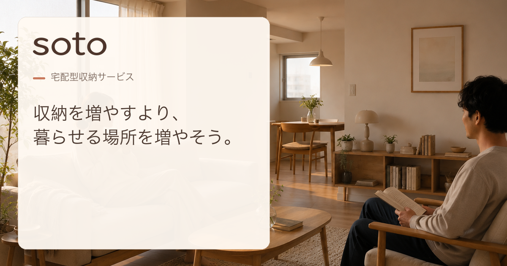

# soto — 宅配型収納サービス LP

> 持っていたいものと、心地よく暮らす。



## Project Overview

「soto」は、季節用品や使用頻度の低い持ち物を自宅から預けられる、架空の宅配型収納サービスです。

都市部の限られた住空間を題材に、サービスの企画、ターゲット・課題設定、ブランド設計、情報設計、画像制作、デザイン、フロントエンド実装、公開までを一貫して行った自主制作の1ページLPです。375pxを起点とするモバイルファーストで設計しました。

Heroでは、サービスの機能より先に利用後の価値を伝えるため、次のコピーを掲げています。

> 収納を増やすより、暮らせる場所を増やそう。

※ 本作品はポートフォリオ用の架空サービスです。実際の申込み・決済機能はありません。

## Live Demo

- [公開サイトを見る](https://coconattsu0723.github.io/soto-storage-lp/)
- [GitHub Repository](https://github.com/Coconattsu0723/soto-storage-lp)

## Concept

ブランドコンセプトは「持っていたいものと、心地よく暮らす。」です。

片付けを「捨てること」と結びつけず、大切なものを持ち続けながら生活空間に余白をつくる選択肢として、宅配型収納を位置づけました。倉庫や段ボールを主役にするのではなく、その先にある穏やかな暮らしを中心に設計しています。

## Target User

- 都市部の1LDK〜2LDKに暮らす、30代前後の共働き夫婦
- 今の家や持ち物を気に入っている
- ミニマリストになりたいわけではない
- 大切なものや必要なものは、無理に手放したくない
- 季節用品や低頻度使用品が生活空間を圧迫している

## User Problem

表面的な悩みは「部屋が狭い」「収納が足りない」ですが、本質的な課題を次のように定義しました。

> 物を減らしたいのではなく、物に生活を圧迫されたくない。

そこで、持ち物を捨てるのではなく、毎日は使わないものを生活空間の外へ移すことで、今の住まいに余白を戻すサービス体験を設計しました。

## Design Strategy

情報の流れは **Lifestyle → Service → Trust**。商品説明から始めず、理想の暮らしを見せて共感をつくり、その後に仕組み・料金・安心材料を段階的に提示しています。

- 写真と余白を主役にし、暮らしの変化を伝える
- キャラクターは理解や安心感を補う役割に限定する
- カードや影を多用せず、画一的なテンプレート感を避ける
- 「静か・丁寧・明快」をブランドの人格として一貫させる
- 日本語は Noto Sans JP、英字ラベルは Inter を使用する

### Color Palette

| Role | Color | HEX |
| --- | --- | --- |
| Base | Warm Ivory | `#FFF9F2` |
| Sub Background | Oat Beige | `#F4E8DA` |
| Main Text | Cocoa Brown | `#4A382F` |
| Sub Text | Taupe Brown | `#7A665B` |
| Main Accent | Soft Terracotta | `#C9795C` |
| Secondary Accent | Apricot | `#E7A56F` |
| Light Accent | Butter Cream | `#F3D58D` |
| Border | Warm Greige | `#DED0C3` |

## Page Structure

ページ全体の心理導線は、**共感 → 気づき → 解決理解 → 安心 → 自分ごと化 → 行動**です。

| Section | 役割 |
| --- | --- |
| Hero | 利用後の理想の暮らしを最初に提示 |
| Problem | 低頻度の持ち物が生活空間を使っていることに気づかせる |
| Brand Philosophy | 大切なものを無理に手放さなくてよいという思想を伝える |
| What is soto | 宅配型収納サービスの仕組みを簡潔に説明 |
| How It Works | 預け入れから取り出しまでの4ステップを示す |
| What You Can Store | 預けられるものを生活カテゴリ別に整理 |
| Before / After Living | 同じ住まいに余白が戻る変化を比較 |
| Storage & Security | 保管環境・管理方法・取り出しやすさで不安を解消 |
| Box / Price | 3サイズのBOXと月額料金を比較 |
| Storage Simulator | 必要なBOX数と月額の目安を提示 |
| Why soto | これまでの価値を「選ぶ理由」として再整理 |
| Voice | 利用シーンを生活者視点で補強 |
| FAQ | 申込み前に残る疑問を解消 |
| Final CTA | 利用後の暮らしを再提示し、行動へつなげる |
| Footer | 補助リンクとブランド情報を整理 |

## Key Features

### Storage Simulator

4つの質問への回答を点数化し、必要なSTANDARD BOX数と月額の目安をVanilla JavaScriptで算出します。

| 合計点 | 判定 | 月額 |
| ---: | ---: | ---: |
| 0〜1点 | 1BOX | 660円 |
| 2〜3点 | 2BOX | 1,320円 |
| 4〜5点 | 3BOX | 1,980円 |
| 6〜8点 | 4BOX | 2,640円 |

月額660円 × BOX数を計算するだけでなく、「自分には何BOX必要か分からない」という申込み前の迷いを減らす意思決定支援として実装しました。未回答時はエラーを表示し、最初の未回答項目へフォーカスを移動します。

### FAQ Accordion

8つのFAQを、複数項目を同時に開けるアコーディオンとして実装しました。質問には`button`を使い、`aria-expanded`と`aria-controls`、回答の`hidden`属性を同期させています。マウス・タッチだけでなく、Tab、Enter、Spaceでも操作できます。

## Responsive Design

375pxを基準に実装し、**375 / 390 / 768 / 1024 / 1366 / 1440px**で表示と操作を確認しました。

画面が広くなったことを理由に機械的に横並びへ変えるのではなく、情報同士を比較しやすくなる箇所だけレイアウトを切り替えています。

- Before / After：モバイルは縦積み、タブレット以上は2列比較
- Box / Price：モバイルは縦積み、タブレット以上は3列比較
- How It Works：タブレット・PCとも、文章と補助イラストの読みやすさを優先した2列×2行
- FAQ：回答の読みやすさを優先し、PCでも1列を維持
- Storage Simulator：全幅で質問の操作順を縦方向に維持し、広い画面では本体を中央配置

## Accessibility

見た目の調整後に追加するのではなく、HTML構造と操作設計の段階からアクセシビリティを組み込みました。

- `lang="ja"`を指定し、`h1`はHeroの1つだけに限定
- 主要セクションを`h2`、セクション内の項目を`h3`とする見出し階層
- 意味のある画像への`alt`、重複説明となる装飾画像への`alt=""`
- 本文へ直接移動できるSkip Link
- CTAや操作要素に44px以上のTap Targetを確保
- Simulatorに`fieldset` / `legend`と関連づけられたRadio labelを使用
- 結果・エラーメッセージに`aria-live`を使用
- FAQの`aria-expanded` / `aria-controls` / `hidden`を同期
- `focus-visible`とキーボード操作を全幅で確認

## Performance Optimization

使用中の画像25点をWeb配信用WebPへ変換し、見た目と透過を維持しながら合計容量を削減しました。元PNGは元素材として残し、HTMLからは最適化版を参照しています。

| Before | After | Reduction |
| ---: | ---: | ---: |
| 40.66 MB | 2.03 MB | 95.0% |

- LCP候補のHero画像に`fetchpriority="high"`を指定
- First View外の画像に`loading="lazy"`を指定
- 画像デコードに`decoding="async"`を使用
- `width` / `height`属性とCSSの`aspect-ratio`で読み込み前の領域を確保し、CLSを抑制

## Tech Stack

| Category | Technology |
| --- | --- |
| Markup | HTML5 |
| Styling | CSS3 |
| Interaction | Vanilla JavaScript |
| Version Control | Git / GitHub |
| Hosting | GitHub Pages |

ChatGPTとCodexは、企画の整理、画像制作の補助、コードレビュー、各幅での反復検証に活用しました。サービス設計や情報の優先順位、デザイン判断、実装内容は、目的と検証結果を照らし合わせながら選定しています。

## Project Structure

```text
.
├── index.html              # LP本体と公開用metadata
├── css/
│   └── style.css           # モバイルファーストのスタイル
├── js/
│   └── script.js           # Simulator / FAQ
├── assets/
│   └── images/             # 写真、キャラクター、アイコン、BOX、OGP、favicon
└── docs/                   # 企画・構成・デザイン・素材・実装ルール・判断記録
```

## Development Process

1. 企画
2. ターゲット・ユーザー課題の設定
3. ブランド設計
4. 情報設計と心理導線の整理
5. 写真・キャラクター・アイコン等の画像制作
6. 375pxを基準としたモバイル実装
7. 390〜1440pxのレスポンシブ調整
8. アクセシビリティと操作性の横断確認
9. WebP化と読込属性による画像最適化
10. OGP / favicon制作とmetadata設定
11. GitHub Pagesで公開

工程ごとにGitのコミットを分け、企画・素材・実装・レスポンシブ・最適化・公開設定の状態を追跡できるようにしました。

## What I Learned

- サービス機能より先に、ユーザーが得たい理想状態を設計することの重要性
- 情報の関係性に応じて、レスポンシブ時の列数や読み順を判断する考え方
- JavaScriptを装飾ではなく、ユーザーの意思決定を助けるために使う設計
- 画像形式・解像度・読込方法が、表示速度と体験に与える影響
- アクセシビリティを後付けにせず、HTMLの意味と操作順から考えること
- Gitを工程の区切りとして使い、変更の目的を履歴に残すこと

## Links

- [Live Demo](https://coconattsu0723.github.io/soto-storage-lp/)
- [GitHub Repository](https://github.com/Coconattsu0723/soto-storage-lp)
